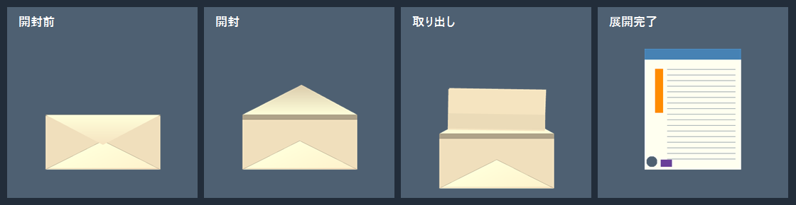

# 開封演出

封筒から手紙を取り出して広げるように、画像を紙として登場させる AviUtl2 のメディアオブジェクトです。手紙、招待状、地図、書類などに使えます。

## ダウンロード

[配布 ZIP をダウンロード](https://github.com/vramwiz/SYNC_PaperOpen/releases/latest/download/SYNC_PaperOpen.zip)。ZIP を展開し、`SYNC_PaperOpen` フォルダーを AviUtl2 のプラグインフォルダーへ入れてください。

## 使い方

1. メディアオブジェクトの追加メニューから「開封演出」を配置し、「紙画像」を指定します。
2. 「プリセット」を選んで「適用」を押します。横長封筒の手紙、封蝋付きの手紙、箱に入った書類、宝の地図、巻物、舞い降りる紙など、12種類から選べます。
3. 必要に応じて、入れ物、開封方法、取り出し方向、展開方法、色を調整します。自分で用意した入れ物を使う場合は、「入れ物の種類」で「ユーザー指定画像」を選び、「容器画像」を指定します。

初期設定では、封筒を開けて三つ折りの紙を取り出し、3秒で画像を広げます。展開後も見せたい場合は、タイムライン上のオブジェクトを長くしてください。

### 演出の調整

- 「入れ物・開封」の「封筒の拡大率」は、紙袋・箱・筒状ケース・ユーザー指定画像にも使えます。折りたたんだ紙が収まる大きさに手動で調整してください。100% の基準寸法は横長・封蝋付きが 640×320 px、縦長が 320×640 px、正方形が 480×480 px、紙袋が 480×560 px、箱が 640×400 px、筒状ケースが 640×240 px です。ユーザー指定画像は縦横比を保ち、長辺を 640 px とします。
- 登場、開封、取り出し、展開、退場の時間を別々に指定できます。0秒にすると、その工程の動きを省略します。
- 折りたたんでいる間は紙の地色を見せ、展開に合わせて画像と透過部分が現れます。「折り目の残り具合」で展開後の折り跡を調整できます。
- 入れ物は残す、消す、フェードアウトや落下で退場させるなどの動きを選べます。紙の位置、拡大率、回転、透明度は標準描画で調整します。

## ライセンス

[GPL-3.0-only](LICENSE) で公開しています。[使用ライブラリのライセンス](THIRD_PARTY_NOTICES.md)
